[English](#english) | [Русский](#russian)

# DALE

## English

**From Dungeon Alchemist or any ordinary image - straight to your Foundry scene.**

A roof you can place separately. A building without the surrounding terrain. A room cut to its own outline. **DALE (Dungeon Alchemist Levels Export)** is a Windows desktop editor for preparing these assets from Dungeon Alchemist exports or ordinary images for use in Foundry VTT.

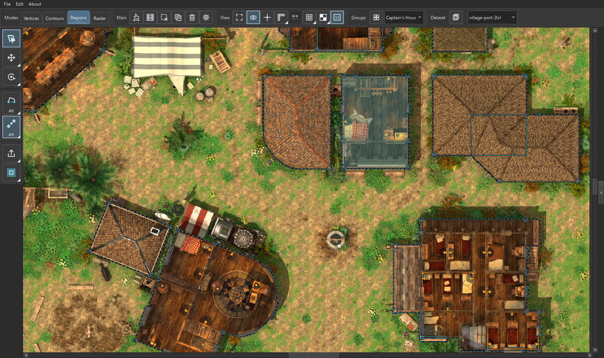

*A working scene from village-port.dale. Contours outline the buildings; the selected building is tinted cyan.*

Work on the image and its contours together: repair boundaries, choose the parts you need, refine transparency and export separate PNGs at the source resolution. An optional Scene JSON supplies editable walls; you can also start with an image alone.

**Open a map. Prepare its boundaries. Export the parts.** Keep ground, upper floors, roofs and other variations together as datasets, then place the resulting images in Foundry using your preferred scene setup.

**Start on Windows x64:** open [DALE/DALE.exe](DALE/DALE.exe). Keep the entire DALE folder together; Python installation is not required. Projects and source files stay local.

**For your Foundry workflow:** import the prepared images and configure their placement, levels and gameplay in Foundry. DALE edits supplied wall geometry and preserves other source Scene JSON data; it does not generate lights, portals or a finished scene. Placement JSON is a coordinate reference for manual setup.

[Editing workflow](docs/workflow.md) | [Portable startup notes](docs/portable-start.txt) | [Project format](docs/project-format.md) | [Architecture](docs/architecture.md)

Examples show actual editor states from the village and jungle projects. Both languages reuse the same English-interface screenshots.

[Download this article as PDF](docs/DALE-guide.pdf).

<strong>Vertices - make the boundary fit the map</strong>

Work at the level of individual points and edges when an imported outline needs a more precise fit.

- Move or insert vertices, draw lines, rectangles and polygonal circles, and erase line sections up to intersections.
- Close gaps and use point, line, guide and right-angle alignment to keep edits controlled. Angle references can include neighbouring corners.

See the example

<table>
<tr>
<td width="50%" valign="top">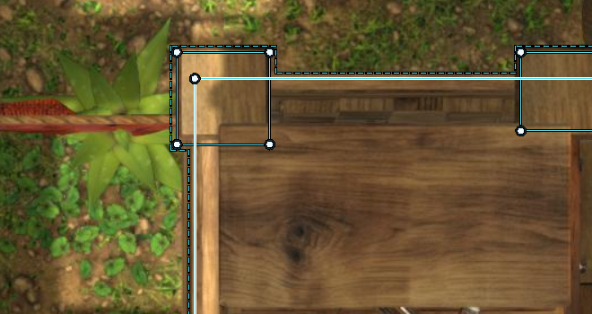 <em>Before: the original corner.</em></td>
<td width="50%" valign="top"> <em>During editing: the two reference legs are highlighted while right-angle alignment is active.</em></td>
</tr>
</table>

<strong>Contours - arrange linework as a whole</strong>

Treat selected edges as a working shape, whether they form a closed outline, an open contour or several separate pieces.

- Move, scale, rotate and mirror a combined selection around its shared logical centre.
- Copy contours between datasets or open projects. The image stays in place while you adjust its linework.

See the example

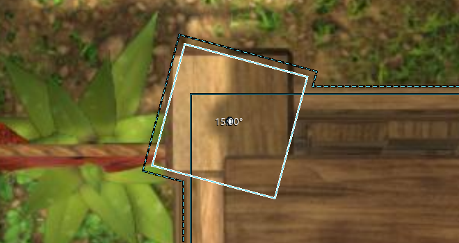

*A small contour rotated as one selection. The centre and cumulative rotation angle remain visible.*

<strong>Regions - turn closed spaces into transparent assets</strong>

Choose the enclosed parts of the map you want to use separately in Foundry: a building, a roof, a room or a custom set of cells.

- Export selected cells individually or merge adjacent selections. Keep unselected inner cells as holes; save a reusable inclusion/exclusion choice in a group.
- Adjust the artwork offset at the edge. Optional grid-sized output adds transparent padding so both corners land on scene-grid boundaries.
- PNG names contain a stable selection number and the actual image dimensions. Optional JSON output includes placement coordinates and, when supplied, the edited source Scene JSON.

See the example

<table>
<tr>
<td width="50%" valign="top">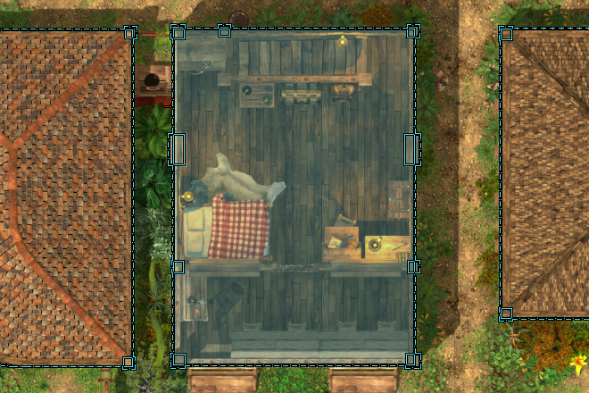 <em>Selected closed cells make up the building.</em></td>
<td width="50%" valign="top">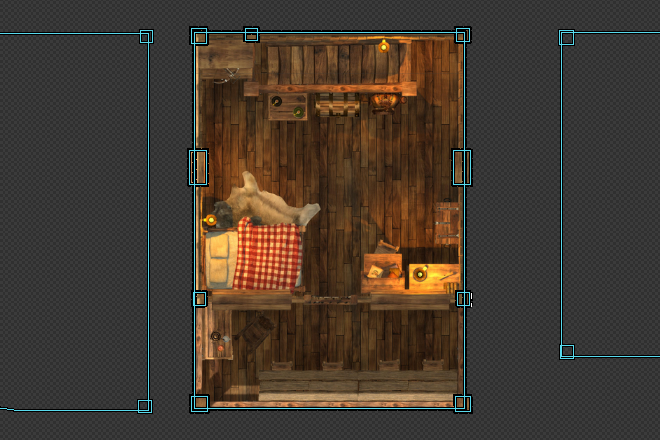 <em>An isolated preview reveals the retained image and transparency before export.</em></td>
</tr>
</table>

Example: two regions become one

Removing a shared internal boundary turns adjacent cells into one region while retaining the outer outline and image.

<table>
<tr>
<td width="50%" valign="top">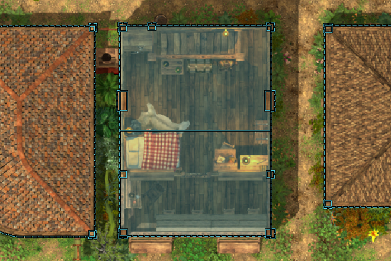 <em>Before: two selected adjacent regions share an internal boundary.</em></td>
<td width="50%" valign="top"> <em>After removing the internal contour: one closed region with the same outer outline.</em></td>
</tr>
</table>

<strong>Raster - refine the image itself</strong>

Clean up the pixels around an asset, or reposition selected imagery independently of the scene walls.

- Erase and restore with round or square brushes, an adjustable soft-edge band and overall strength.
- Move, scale and rotate a raster selection with its own boundary. Preview the selected result and inspect visible tiles at native resolution.

See the example

<table>
<tr>
<td width="50%" valign="top">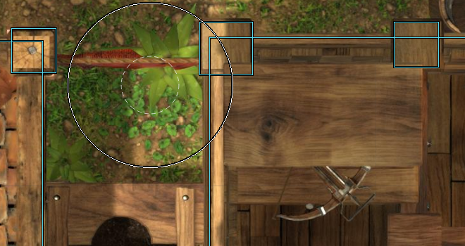 <em>Before: original imagery beside the contour.</em></td>
<td width="50%" valign="top">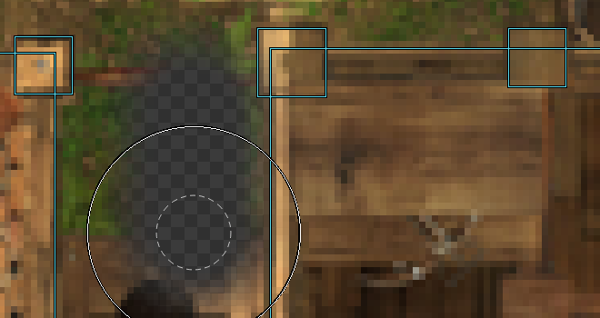 <em>After a soft eraser stroke: the checkerboard shows the newly transparent area.</em></td>
</tr>
</table>

Example: rotate the image, not just its outline

The selected imagery rotates with its independent raster boundary. The scene wall contours retain their original positions.

<table>
<tr>
<td width="50%" valign="top">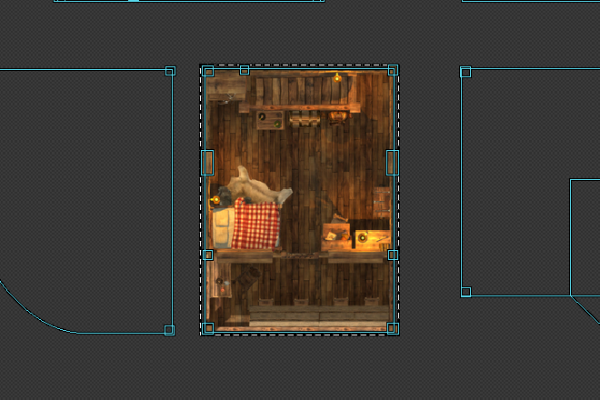 <em>Before rotation: the selected raster image.</em></td>
<td width="50%" valign="top">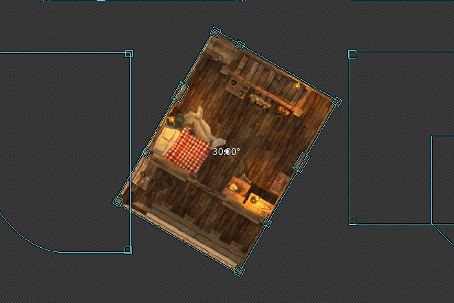 <em>After a 30-degree rotation: the image and its raster boundary turn together.</em></td>
</tr>
</table>

<strong>Groups - return to the selections that matter</strong>

Give a useful selection a name and colour instead of finding the same building again before every operation.

- Each dataset and editing mode has its own groups. Add or remove selected elements explicitly; an element can belong to several groups.
- Recall a group, reorder its place in the list and use a matching region group name when exporting. The compact manager stays over the workspace while the map moves beneath it.

See the example

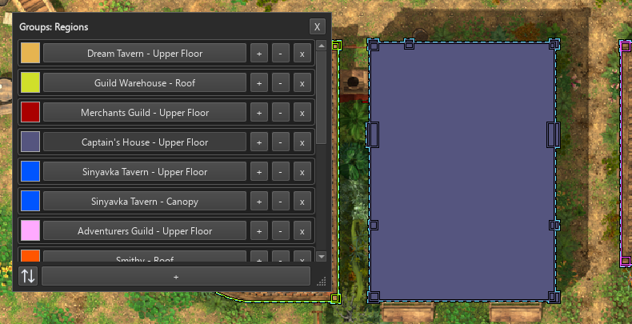

*The group manager beside the selected building. Group colours make saved membership visible.*

<strong>Datasets - keep one location together</strong>

Organise related map images and their contours inside one .dale project rather than treating every export as a separate job.

- Switch between ground, upper floors, roofs and underground maps with a saved view for each dataset.
- Use the dataset manager to create and rename sets, transfer images or JSON, and merge contour data when needed. Save source assets, applied contours, groups and settings together. Undo/redo stays in the running session and starts empty when a project opens. The title shows the current project filename; progress remains visible while manager Apply prepares and publishes the new dataset.

See the example

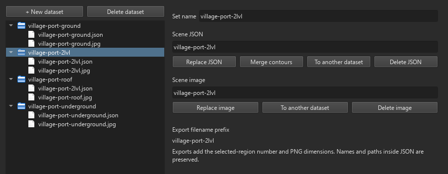

*The example project contains four datasets. The manager exposes their images and Scene JSON separately.*

<strong>View - measure, align and inspect</strong>

Keep useful visual references on the map while changing editing modes.

- Use rulers, persistent guides, a cursor crosshair and a configurable scene grid. Rulers support pixels and game-world feet, centimetres or millimetres when scene metadata permits.
- Inspect native-resolution tiles, choose a workspace background and retain each dataset's zoom and camera position. Guides and grid overlays are not burned into PNGs. Zoom is bounded during navigation and project reopening. New project restores the ordinary checkerboard, and the first imported map fits its real dimensions.

See the example

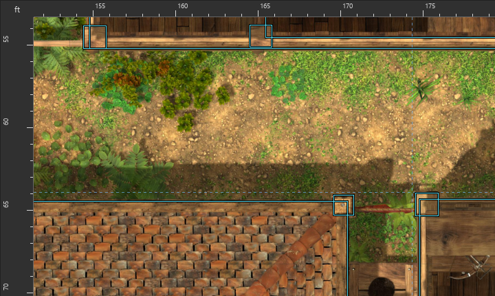

*Rulers, a scene grid and map-anchored guides around a working area.*

<strong>Tool settings - options where you need them</strong>

A filled lower-right corner marks a tool with extra options. **Right-click the tool** to open its settings beside the map.

- Set tolerances, rotation steps, brush behaviour or export options in a nonmodal panel. Apply commits the changes; Cancel discards them.
- Remember a recurring answer, change it later or return to asking every time. Controls and contextual help are available in English and Russian.

See the example

<table>
<tr>
<td width="18%">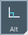 <em>Right-click this marked tool.</em></td>
<td>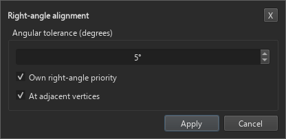 <em>Right-clicking Right-angle alignment opens its tolerance and behaviour settings.</em></td>
</tr>
</table>

<strong>DA contours - turn local 3D assets into map obstacles</strong>

Attach a Dungeon Alchemist DAM file to a dataset in the manager. DALE reads installed models and textures and projects their visible outer silhouettes onto the map. This works locally, without AI services or internet access. Workshop assets must already be downloaded; missing assets need to be opened in Dungeon Alchemist first.

- The DA contours section has separate Wall, Tree, Bush and Rock controls and groups. Toggle a whole category or set its global minimum original size and height in the category's right-click settings.
- Select complete placed objects, including their separate pieces. Rotate and scale around each object's own centre. Object movement and individual point/edge editing remain available in the ordinary sections only.
- DALE remembers the last size, extra rotation, slices and complexity you chose for each asset type. A new DAM import asks whether to use those settings or the original placement. Existing .dale projects retain their own geometry. Clearing the cache also clears these remembered defaults.

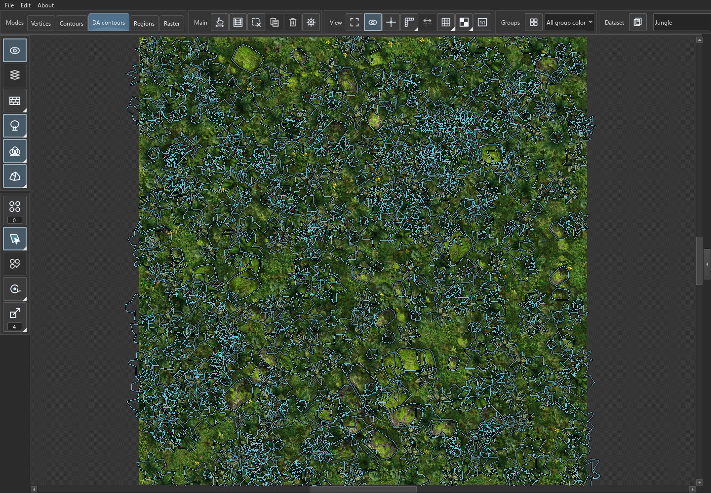

*Trees, bushes and rocks remain independent placed objects, with category visibility and whole-object tools.*

<strong>Object slices - choose height and simplify the outer shape</strong>

Select DA objects and open Object slices below the contour display control. The movable panel remembers its position and has four category tabs. Its active category is isolated temporarily; closing the panel restores the other enabled categories. Clearing the last selection closes the panel.

- Slice levels run from 0 to 10 over the actual model height. Ground mode follows the local surface. Enable Slice range to combine the slices between the lower and upper boundaries; the preview marks that range in cyan.
- Size and Contour complexity affect the selected objects. Each complexity request rebuilds the polygon from the original detailed outline, preserving outer coverage and broad features. The minimum is four vertices per perimeter. Contacting parts of the same asset may form a common outer contour; independent objects stay independent.
- Changing the slice reapplies the chosen complexity. A slider drag starts its calculation on release; a newer request supersedes stale work. Long calculations show progress. Changes share an undo segment until the selection changes or the panel closes.

<table><tr>
<td width="50%">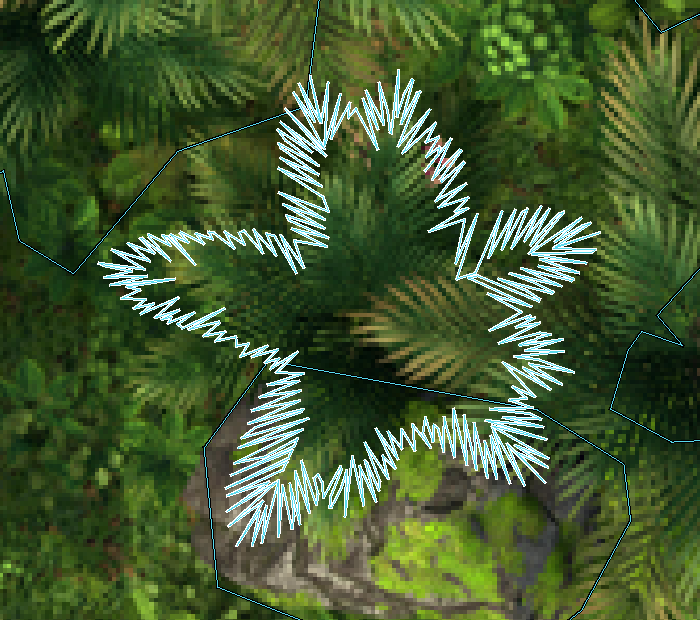 <em>Maximum complexity: all fine leaf edges.</em></td>
<td width="50%">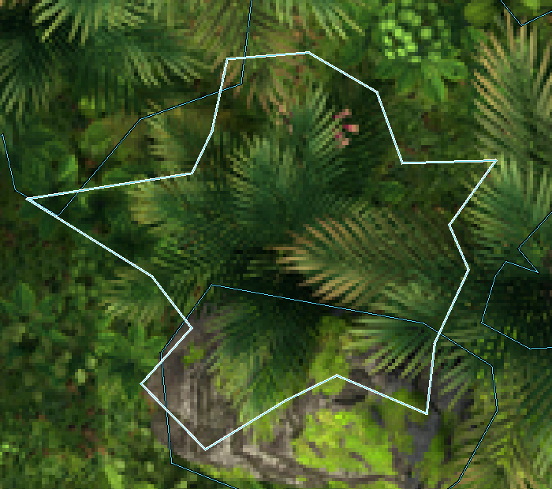 <em>Complexity 18: the broad outer shape.</em></td>
</tr></table>

Both images show the same object at the same zoom and slice range. Only contour complexity changes.

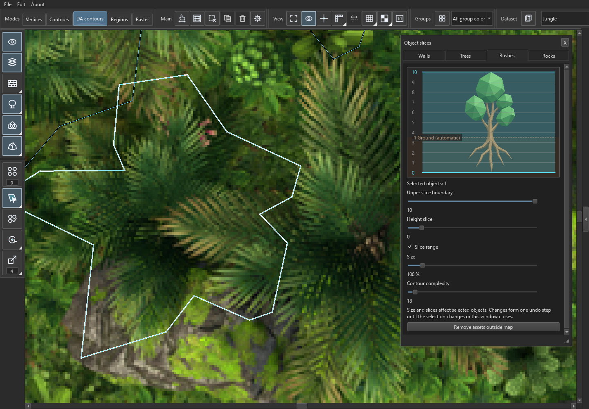

*The preview explains the height range; the map displays the applied contour.*

<strong>Thinning - reduce overlapping obstacles reversibly</strong>

Use Thin objects and Ctrl+wheel over its value to set strength from 0 to 10. It examines trees, bushes and rocks together across the active dataset, independently of selection.

- It removes redundancy where objects actually overlap, favouring external coverage and a more even distribution. A dense group of small, separate objects is not removed just because they are nearby.
- At 0 all objects return; at 10 the surviving objects are disjoint. Intermediate values retain more overlap. This is useful when preparing dense jungle obstacles without stacking several walls in the same place.
- Hidden objects stay out of exports. Returning objects recover the user's retained selection; newer selection changes and explicit clearing are respected.

<table><tr>
<td width="50%">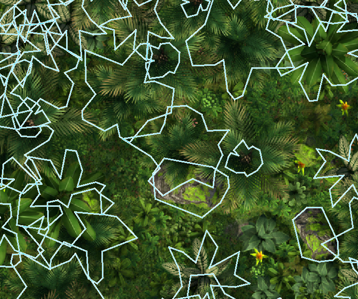 <em>0: original overlapping obstacles.</em></td>
<td width="50%">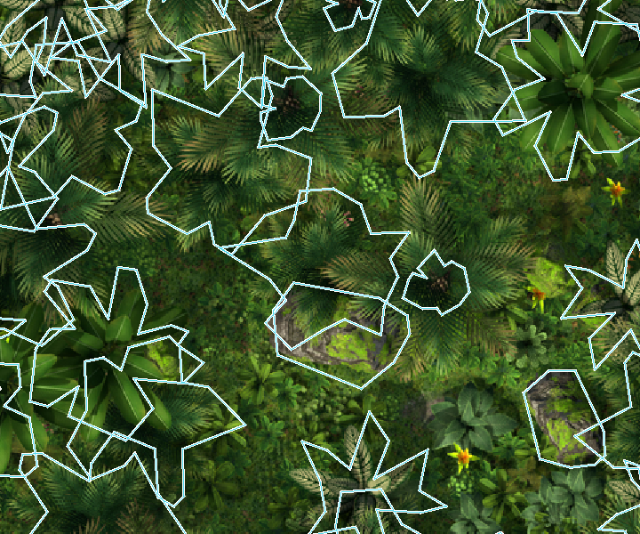 <em>5: fewer overlaps; the image is unchanged. White outlines mark selected objects.</em></td>
</tr></table>

<strong>Export - choose the files and the contour source</strong>

Right-click Export selected regions to configure the output before exporting.

- PNG and JSON have independent checkboxes. Disable PNG for a JSON-only export without image rendering; keep at least one format enabled.
- Only DA contours excludes ordinary lines from JSON and restricts PNG cutting areas to visible DA contours inside the chosen regions. Disabled categories and thinned objects stay excluded.
- Merge adjacent contours groups neighbouring selected regions into PNGs and removes interior JSON boundaries only during export. The editable project keeps its separate objects.
- Optional height normalization sets exported base/top wall heights without changing the project. Category JSON settings remain on the category buttons.
- Scene JSON preserves the supplied scene's other data. When both file formats are enabled, the placement JSON describes the exported images; it is not an automatic Foundry scene builder.

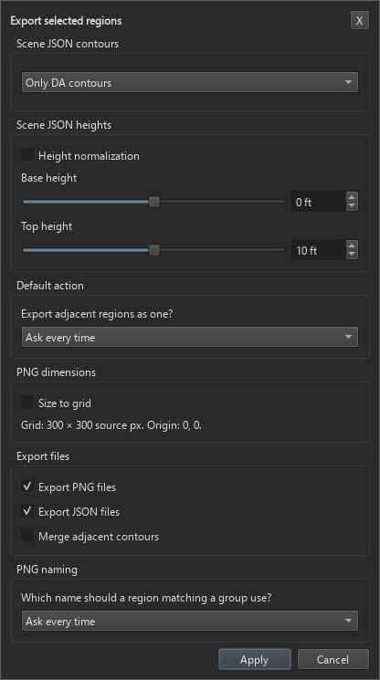

## Русский

**Из Dungeon Alchemist или любой обычной картинки - прямиком на сцену Foundry.**

Крыша, которую можно разместить отдельно. Здание без окружающей земли. Комната, вырезанная точно по своему контуру. **DALE (Dungeon Alchemist Levels Export)** - настольный редактор для Windows, который помогает подготовить такие элементы из выгрузок Dungeon Alchemist или обычных изображений для Foundry VTT.

*Рабочая сцена из village-port.dale. Контуры очерчивают здания; выбранное здание выделено голубым.*

Работайте с изображением и контурами вместе: исправляйте границы, выбирайте нужные части карты, уточняйте прозрачность и выгружайте отдельные PNG в исходном разрешении. JSON сцены добавляет редактируемые стены, но начать можно и с одного изображения.

**Откройте карту. Подготовьте границы. Выгрузите нужные части.** Храните поверхность, этажи, крыши и другие варианты в наборах одного проекта, а полученные изображения размещайте в Foundry согласно своему устройству сцены.

**Запуск в Windows x64:** откройте [DALE/DALE.exe](DALE/DALE.exe). Переносите папку DALE целиком; устанавливать Python не требуется. Проекты и исходники остаются на вашем компьютере.

**Для работы в Foundry:** разместите подготовленные изображения и настройте этажи и игровые свойства в самой Foundry. DALE редактирует переданную геометрию стен, сохраняя прочие данные исходного JSON сцены; свет, порталы и готовую сцену программа не генерирует. JSON размещения - справочник координат для ручной настройки.

[Рабочий процесс](docs/workflow.md) | [Запуск portable-версии](docs/portable-start.txt) | [Формат проекта](docs/project-format.md) | [Архитектура и разработка](docs/architecture.md)

Примеры показывают настоящие состояния редактора на проектах деревни и джунглей. Обе языковые версии используют общие скриншоты английского интерфейса.

[Скачать эту статью в PDF](docs/DALE-guide.pdf).

<strong>Вершины - подгоните границу под карту</strong>

Работайте с отдельными точками и отрезками, когда исходному контуру нужна более точная форма.

- Перемещайте и добавляйте вершины, рисуйте линии, прямоугольники и многоугольные окружности, стирайте участки линий до пересечений.
- Замыкайте разрывы и используйте привязки к точкам, линиям, направляющим и прямым углам. При выравнивании можно учитывать и соседние углы.

Посмотреть пример

<table>
<tr>
<td width="50%" valign="top"> <em>До правки: исходный угол.</em></td>
<td width="50%" valign="top"> <em>Во время правки: две опорные линии подсвечены при действующей привязке к прямому углу.</em></td>
</tr>
</table>

<strong>Контуры - работайте с линиями как с целым</strong>

Обращайтесь с выбранными отрезками как с одной рабочей фигурой: замкнутой, открытой или состоящей из нескольких отдельных частей.

- Перемещайте, масштабируйте, вращайте и отражайте общее выделение относительно его логического центра.
- Копируйте контуры между наборами и открытыми проектами. Изображение остаётся на месте, пока вы меняете линии поверх него.

Посмотреть пример

*Небольшой контур повёрнут целиком. В центре видны опорная точка и суммарный угол вращения.*

<strong>Области - превратите замкнутые участки в отдельные изображения</strong>

Выберите здание, крышу, комнату или несколько замкнутых ячеек, чтобы использовать их как самостоятельные элементы Foundry.

- Выгружайте ячейки отдельно или объединяйте смежные. Невыбранные внутренние ячейки останутся отверстиями; состав с исключениями можно сохранить в группе.
- Регулируйте отступ изображения. Размер под сетку добавит прозрачные поля, чтобы углы PNG совпали с границами клеток.
- PNG получают стабильный номер выделения и фактические размеры в имени. Дополнительно выгружаются JSON с координатами размещения и изменённый исходный JSON сцены.

Посмотреть пример

<table>
<tr>
<td width="50%" valign="top"> <em>Выбранные замкнутые ячейки составляют здание.</em></td>
<td width="50%" valign="top"> <em>Изолированный предпросмотр показывает сохраняемую картинку и прозрачность до выгрузки.</em></td>
</tr>
</table>

Пример: две области становятся одной

Удаление общей внутренней границы превращает соседние ячейки в одну область, сохраняя внешний контур и изображение.

<table>
<tr>
<td width="50%" valign="top"> <em>До: две выбранные смежные области разделены внутренней границей.</em></td>
<td width="50%" valign="top"> <em>После удаления внутреннего контура: одна замкнутая область с прежней внешней границей.</em></td>
</tr>
</table>

<strong>Растр - доработайте само изображение</strong>

Очищайте изображение и меняйте положение его частей независимо от стен сцены.

- Стирайте и восстанавливайте изображение круглой или квадратной кистью с настраиваемой мягкой кромкой и общим нажимом.
- Перемещайте, масштабируйте и вращайте растровую область с её изображением. Проверяйте предпросмотр и видимые фрагменты в исходном разрешении.

Посмотреть пример

<table>
<tr>
<td width="50%" valign="top"> <em>До обработки: исходное изображение рядом с контуром.</em></td>
<td width="50%" valign="top"> <em>После прохода мягким ластиком: шахматный фон показывает появившуюся прозрачность.</em></td>
</tr>
</table>

Пример: вращение самой картинки

Выбранное изображение вращается вместе со своей независимой растровой границей. Контуры стен сцены сохраняют исходное положение.

<table>
<tr>
<td width="50%" valign="top"> <em>До вращения: выбранное растровое изображение.</em></td>
<td width="50%" valign="top"> <em>После поворота на 30 градусов: изображение и его растровая граница повёрнуты вместе.</em></td>
</tr>
</table>

<strong>Группы - возвращайтесь к важным выделениям</strong>

Дайте полезному выделению имя и цвет, чтобы не искать одно и то же здание перед каждой операцией.

- У каждого набора и режима свой список групп. Добавляйте и исключайте выбранные элементы явно; один элемент может входить в несколько групп.
- Выбирайте сохранённую группу, меняйте порядок списка и используйте имя совпадающей группы областей при выгрузке. Компактный менеджер остаётся над рабочей областью при перемещении карты.

Посмотреть пример

*Менеджер групп рядом с выбранным зданием. Цвета помогают видеть состав сохранённых групп.*

<strong>Наборы - держите одну локацию вместе</strong>

Соберите связанные изображения карты и их контуры в одном проекте .dale вместо отдельных рабочих файлов на каждый вариант.

- Переключайтесь между поверхностью, этажами, крышами и подземельем с сохранённым положением камеры для каждого набора.
- В менеджере наборов создавайте и переименовывайте наборы, переносите изображения или JSON и при необходимости объединяйте контуры. Сохраняйте исходники, применённые контуры, группы и настройки вместе. История отмены остаётся в текущем сеансе и очищается при открытии проекта. Заголовок показывает имя проекта; «Применить» в менеджере показывает прогресс подготовки и отображения набора.

Посмотреть пример

*В примере четыре набора. Менеджер показывает их изображения и JSON сцены отдельными компонентами.*

<strong>Вид - измеряйте, выравнивайте и проверяйте</strong>

Держите полезные ориентиры на карте при переключении между режимами редактирования.

- Используйте линейки, сохраняемые направляющие, перекрестие курсора и настраиваемую сетку сцены. Линейки показывают пиксели и, при наличии данных сцены, игровые футы, сантиметры или миллиметры.
- Рассматривайте фрагменты в исходном разрешении, выбирайте фон рабочей области и возвращайтесь к сохранённому масштабу и положению камеры. Направляющие и экранная сетка не попадают в PNG. Масштаб ограничен и при навигации, и при открытии проекта. Новый проект возвращает обычную шахматную подложку, а первая импортированная карта подстраивается под окно по своим реальным размерам.

Посмотреть пример

*Линейки, сетка сцены и привязанные к карте направляющие вокруг рабочего участка.*

<strong>Настройки инструментов - нужные параметры рядом</strong>

Заполненный нижний правый угол отмечает инструмент с дополнительными возможностями. **Нажмите на него правой кнопкой мыши**, чтобы открыть настройки рядом с картой.

- Меняйте допуски, шаг вращения, поведение кисти и параметры выгрузки в немодальной панели. Применение сохраняет изменения, отмена их отбрасывает.
- Запоминайте ответ на повторяющийся вопрос, меняйте его позже или возвращайте вариант «Спрашивать каждый раз». Интерфейс и контекстные подсказки доступны на русском и английском.

Посмотреть пример

<table>
<tr>
<td width="18%"> <em>Правый клик по этой кнопке с уголком.</em></td>
<td> <em>Правый клик по инструменту «Прямые углы» открывает допуск и настройки поведения привязки.</em></td>
</tr>
</table>

<strong>Контуры DA - препятствия на карте из локальных 3D-ассетов</strong>

Подключите файл DAM из Dungeon Alchemist к набору через менеджер. DALE читает установленные модели и текстуры и проецирует их видимые внешние силуэты на карту. Всё работает локально, без нейросетевых сервисов и интернета. Ассеты Workshop должны быть уже загружены; если их не хватает, сначала откройте карту в Dungeon Alchemist.

- В разделе Контуры DA есть отдельные кнопки стен, деревьев, кустов и камней, а также собственные группы. Кнопка скрывает всю категорию; минимальный исходный размер и высота задаются в её настройках по правому клику и действуют глобально.
- Выделяйте объекты целиком, включая отдельные части одного ассета. Вращайте и масштабируйте каждый относительно собственного центра. Перемещение и правка отдельных точек и рёбер доступны только в обычных разделах.
- DALE запоминает последние выбранные размер, дополнительный поворот, нарезку и сложность каждого типа ассета. При новом импорте DAM программа предлагает применить их или оставить исходное размещение. Проект .dale открывается со своей геометрией. Очистка кэша удаляет и эти запомненные параметры.

*Деревья, кусты и камни остаются отдельными объектами с видимостью по категориям и инструментами для целого объекта.*

<strong>Нарезка объектов - высота и упрощение внешней формы</strong>

Выделите объекты DA и откройте Нарезку объектов кнопкой под отображением контуров. Перемещаемое окно запоминает положение и содержит четыре вкладки категорий. Активная категория временно показывается отдельно; после закрытия возвращаются остальные включённые категории. Снятие всего выделения закрывает окно.

- Уровни от 0 до 10 привязаны к реальной высоте модели. Режим земли учитывает местную поверхность. Галочка Диапазон нарезки объединяет срезы между нижней и верхней границами; на превью диапазон отмечен голубым.
- Размер и Сложность контура действуют на выделенные объекты. Каждое значение сложности строит фигуру заново из исходного подробного контура, сохраняя внешнее покрытие и крупные элементы. Минимум - четыре вершины на периметр. Соприкоснувшиеся части одного ассета могут образовать общий внешний контур; разные объекты остаются независимыми.
- После изменения нарезки выбранное упрощение применяется повторно. Перетаскивание ползунка запускает расчёт после отпускания; новый запрос отменяет устаревший. Долгие операции показывают прогресс. Изменения объединяются в шаг отмены до смены выделения или закрытия окна.

<table><tr>
<td width="50%"> <em>Максимальная сложность: мелкие края листьев.</em></td>
<td width="50%"> <em>Сложность 18: крупная внешняя форма.</em></td>
</tr></table>

На обоих снимках один объект при одинаковом масштабе и диапазоне нарезки. Меняется только сложность контура.

*Превью поясняет диапазон высот, а карта показывает применённый контур.*

<strong>Прореживание - обратимое уменьшение наложений</strong>

Кнопка Прореживание и Ctrl+колесо над её значением задают силу от 0 до 10. Расчёт рассматривает деревья, кусты и камни вместе во всём текущем наборе, независимо от выделения.

- Убирается избыточность там, где объекты действительно пересекаются, с приоритетом внешнего покрытия и более равномерного заполнения. Много мелких раздельных объектов не удаляются только из-за близости.
- При 0 все объекты возвращаются; при 10 оставшиеся объекты не соприкасаются. Средние значения сохраняют больше перекрытий. Это помогает готовить густые джунгли без множества стен почти в одном месте.
- Скрытые объекты не выгружаются. Вернувшиеся объекты восстанавливают запомненное выделение пользователя; последующие изменения выбора и его явная очистка учитываются.

<table><tr>
<td width="50%"> <em>0: исходные перекрытия.</em></td>
<td width="50%"> <em>5: меньше перекрытий; изображение не меняется. Белым показаны выделенные контуры.</em></td>
</tr></table>

<strong>Экспорт - выбор файлов и источника контуров</strong>

Откройте настройки Экспорта выбранных областей правым кликом перед выгрузкой.

- У PNG и JSON отдельные галочки. Отключите PNG для выгрузки одного JSON без обработки изображения; хотя бы один формат должен оставаться включённым.
- Только Контуры DA исключает обычные линии из JSON и ограничивает области PNG видимыми контурами DA внутри выбранных областей. Отключённые категории и прореженные объекты не возвращаются в выгрузку.
- Объединять смежные контуры группирует соседние выбранные области в PNG и убирает внутренние границы в JSON только при экспорте. В проекте объекты остаются отдельными.
- Нормализация высоты при необходимости задаёт высоты основания и верха выгружаемых стен, не меняя проект. Параметры JSON категорий остаются в кнопках категорий.
- JSON сцены сохраняет прочие данные исходной сцены. При включённых обоих форматах JSON размещения описывает экспортированные картинки; автоматическую сцену Foundry он не создаёт.

