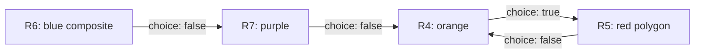

# Foundry scene probe: observed format

Checked 2026-10-16. Status: analysis only; no new importer, semantic editor or Foundry exporter is implemented by this research. Read [export feasibility](foundry-export-feasibility.md) for the proposed implementation boundaries and [the machine profile](../project/foundry-format-profile.json) for indexed observations.

## Evidence and scope

The owner supplied `examples/fvtt-Scene-test-2WsAkxPbpDPmK2o4.json` and two screenshots showing wall variants and regions. The file is one UTF-8 scene object, 20,764 bytes, SHA-256 `a2fc432fde70b8009ef9691e1501005e658522040528b1ab0613d333684627d2`. It contains no Unicode replacement characters. Private source files remain ignored; aliases below replace world/document identifiers. `Wn` means `/walls/n`, `Rn` means `/regions/n`, both zero-based, not screen order or Foundry IDs.

`_stats.coreVersion` and `_stats.exportSource.coreVersion` are **13.351**; the game system is **dnd5e 5.3.3**. Module versions are not recorded. The official v13 API currently identifies itself as 13.350; its schema is corroborating evidence, not a runtime test of this exact patch. v14 references describe the separately published v14 schema, not an owner-supplied v14 export.

The file contains sufficient structure to describe the demonstrated v13 walls, shapes and directed teleport connections. It is not a complete specification for every Foundry setting or for native v14 floors. Screenshots help interpret the test arrangement; names and colors do not override serialized values.

## Scene inventory

| Path | Observed value | Meaning for DALE |
| --- | --- | --- |
| `/width`, `/height` | 4000, 3000 | Scene rectangle dimensions, not the full padded canvas. |
| `/padding` | 0.25 | Coordinate origin needs padding/grid handling. |
| `/grid` | Object: type 1, size 100, distance 5, units `ft` | Square grid; 20 horizontal pixels per foot before image scaling. |
| `/background` | `src:null`, anchors/offsets 0, scale 1, rotation 0, fit `fill` | No background image embedded or referenced. |
| `/foreground`, `/foregroundElevation`, `/thumb` | `null` | No floor artwork or foreground elevation evidence. |
| `/walls` | 12 records | Independent segments with gameplay settings. |
| `/regions` | 9 records, 13 shapes, 4 behaviors | Composite regions and teleport links. |
| `/tokens` | 1 record, elevation 20 | A token's position/height, not a floor definition. |
| `/drawings` | 2 records | The wall/region section labels visible in the screenshots. |
| `/lights`, `/notes`, `/sounds`, `/templates`, `/tiles` | All empty arrays | Collections exist, but their populated schemas are not demonstrated. |
| `/flags/wall-height/advancedVision` | `true` | Wall Height module setting. |
| `/levels` | Absent | No native v14 Level documents. |
| Root `/_id` | Absent | Never derive the new scene's identity from an assumed root ID. |
| `/_stats/exportSource/uuid` | Source scene UUID present | Historical identity; all four teleport links refer to that scene. |

Other scene groups include environment, fog, token vision, navigation, ownership, folder/journal/playlist references and export statistics. Here `tokenVision` is true, fog exploration is enabled, darkness is 0, and global illumination is disabled. Preserve relevant map appearance independently of geometry. Tokens may refer to world Actors; media and referenced world documents are not packed into this JSON.

### Canvas coordinates and padding

Some shapes extend to Y=3200, beyond `height=3000`. That alone does not make them invalid: embedded objects use canvas coordinates and the scene rectangle sits inside a padded canvas. [Scene.getDimensions](https://foundryvtt.com/api/v13/classes/foundry.documents.Scene.html#getDimensions) applies padding and grid rounding; [SceneDimensions](https://foundryvtt.com/api/v13/interfaces/foundry.documents.types.SceneDimensions.html) exposes `sceneX`, `sceneY`, scene dimensions and outer dimensions separately.

A candidate calculation for this probe gives scene origin **(1000, 800)** and outer canvas **6000 × 4600** after symmetric grid rounding. This is an inference, not a captured runtime result: verify `canvas.scene.getDimensions()` on 13.351 before implementing the transform. Do not simply subtract `height * padding` and assume fractional-grid margins are exact.

DALE currently scales `walls[].c` using scene dimensions, background offsets and internal origin metadata. It warns about padding but does not automatically resolve this modern padded profile; the UI no longer exposes origin controls. Current JPG compatibility therefore must not be inferred from successfully reading this test JSON. No matching JPG is supplied for this probe. Keep image coordinates, scene-rectangle coordinates and padded-canvas coordinates explicit; clamp PNGs only after converting to original JPG coordinates.

## Wall schema

The [v13 BaseWall schema](https://foundryvtt.com/api/v13/classes/foundry.documents.BaseWall.html) separates coordinates, restrictions, direction, doors, thresholds, animation, audio and flags. The source contains these groups:

| Field | Representation | Interpretation |
| --- | --- | --- |
| `_id` | Unique 16-character alphanumeric ID in this sample | Embedded wall identity; different from DALE lineage IDs. |
| `c` | `[x1,y1,x2,y2]` | Ordered segment endpoints. |
| `move` | 0 or 20 | Movement restriction. |
| `light`, `sight`, `sound` | Independently selected numeric enums | Separate sensory restrictions; do not combine into one wall type. |
| `dir` | 0, 1 or 2 | Both, left, right relative to ordered endpoints. |
| `door` | 0, 1 or 2 | No door, ordinary door, secret door. |
| `ds` | 0, 1 or 2 | Closed, open, locked. |
| `threshold` | `light`, `sight`, `sound`, `attenuation` | Distance-sensitive restriction parameters; nullable values are preserved. |
| `animation` | `null` or settings object | Not the wall's collision/sight rule. |
| `doorSound` | Absent or empty string | No nonempty sound is demonstrated. |
| `flags` | Namespaced objects | Extension data, including module wall heights. |

Official constants: sensory restrictions are **NONE=0, LIMITED=10, NORMAL=20, PROXIMITY=30, DISTANCE=40**; movement is **NONE=0, NORMAL=20**. DISTANCE corresponds to reverse proximity in the wall UI. These numbers are not the older Dungeon Alchemist `sense` values. See [sense constants](https://foundryvtt.com/api/v13/variables/CONST.WALL_SENSE_TYPES.html), [movement constants](https://foundryvtt.com/api/v13/variables/CONST.WALL_MOVEMENT_TYPES.html), [directions](https://foundryvtt.com/api/v13/variables/CONST.WALL_DIRECTIONS.html), [door types](https://foundryvtt.com/api/v13/variables/CONST.WALL_DOOR_TYPES.html) and [door states](https://foundryvtt.com/api/v13/variables/CONST.WALL_DOOR_STATES.html).

### Actual wall combinations

Every sample wall runs from X=1200 to X=1700. Table order follows increasing Y; original array order differs. `L/V/S/M` means light/sight/sound/movement.

| Wall | Y | L/V/S/M | Direction | Door/state | Additional data |
| --- | ---: | --- | --- | --- | --- |
| W0 | 1100 | 20/20/20/20 | Both | None/closed | Ordinary blocking segment. |
| W1 | 1200 | 10/10/10/20 | Both | None/closed | Limited sensory restriction. |
| W2 | 1300 | 0/0/0/20 | Both | None/closed | Blocks movement only. |
| W6 | 1400 | 20/20/20/20 | Both | Ordinary/closed | Door. |
| W3 | 1500 | 20/20/20/20 | Both | Ordinary/locked | Animation object; module height null/null. |
| W7 | 1600 | 20/20/20/20 | Both | Ordinary/open | Animation object; module height null/null. |
| W4 | 1700 | 20/20/20/20 | Both | Secret/closed | Secret door. |
| W5 | 1800 | 30/30/20/20 | Both | None/closed | Light/sight thresholds 10; attenuation true, window-like settings. |
| W8 | 1900 | 30/20/20/20 | Both | None/closed | Light threshold 5; attenuation false. |
| W9 | 2000 | 10/40/0/0 | Both | None/closed | Null thresholds; module top 10, bottom 100. |
| W10 | 2100 | 10/20/20/20 | Left | None/closed | Module height null/null. |
| W11 | 2200 | 30/20/20/20 | Right | None/closed | Light threshold 10; module height null/null. |

The ordinary door covers all three states, while the secret door only demonstrates closed. W3/W7 contain animation `type:""`, `texture:null`, `flip:false`, `double:false`, `direction:1`, `duration:750`, `strength:1`, with `doorSound:""`. These objects do not demonstrate a configured animation asset or multiple animation styles.

Windows, terrain walls, invisible walls and combined presets are configurations of restrictions rather than separate JSON document classes. Restrictions can be combined with door type and direction; preserve the actual fields instead of reverse-engineering a preset name. Animated door hinges depend on endpoint order. See the [wall configuration guide](https://foundryvtt.com/article/walls/).

**Owner rule:** accept setting combinations that Foundry permits, including W9's unusual restriction/threshold combination. Do not reject records because a preset looks unexpected. The original JSON stays exact. A future working/export representation may normalize swapped finite wall-height bounds to `bottom=min(a,b)`, `top=max(a,b)`, retaining the original values and recording that normalization. Here the normalized interval would be 10..100. Null bounds remain unbounded; they are not zero. Runtime effects of this exact unusual record have not been tested.

### Wall Height is extension data

Six walls have `flags["wall-height"]`; five contain top/bottom nulls and W9 contains the finite pair above. The [core v13 wall schema](https://foundryvtt.com/api/v13/classes/foundry.documents.BaseWall.html) has no native top/bottom wall-height fields. These flags belong to [Wall Height](https://foundryvtt.com/packages/wall-height), not core floor documents.

The author's [current implementation of getWallBounds](https://github.com/theripper93/wall-height/blob/main/scripts/utils.js) maps absent/null top to positive infinity and bottom to negative infinity. The [author documentation](https://wiki.theripper93.com/free/wall-height) distinguishes wall bounds, token elevation and token physical height. Its current page is labeled v14 and the installed module build is unknown: pin and test the actual v13 module before claiming exact runtime equivalence. Wall Height alone does not establish a complete multi-floor visibility workflow. No Levels module data is demonstrated here.

## Region schema and geometry

Each region has `_id`, `name`, `color`, `shapes`, `elevation:{bottom,top}`, `behaviors`, `visibility`, `locked`, `flags` and export statistics. All are unlocked; their flags are empty. A [Region](https://foundryvtt.com/api/v13/classes/foundry.documents.BaseRegion.html) is independent of walls: its boundary is explicitly stored, not implicitly reconstructed from `walls[]`.

The serialized shape variants observed here are:

| Type | Shape fields besides `type`, `hole` | Sample use |
| --- | --- | --- |
| `rectangle` | `x`, `y`, `width`, `height`, `rotation` | Seven shapes; x/y position and dimensions. |
| `ellipse` | `x`, `y`, `radiusX`, `radiusY`, `rotation` | Five shapes; center and radii, including circular-looking ellipses. |
| `polygon` | `points:[x0,y0,x1,y1,...]` | One concave eight-vertex shape; first point is not repeated. |

Compare the official [rectangle](https://foundryvtt.com/api/v13/classes/foundry.data.RectangleShapeData.html), [ellipse](https://foundryvtt.com/api/v13/classes/foundry.data.EllipseShapeData.html) and [polygon](https://foundryvtt.com/api/v13/classes/foundry.data.PolygonShapeData.html) models. A dedicated `circle` type also exists in the public shape model, but is not present in this file. All observed rotations are zero; rotated-shape anchor behavior still needs a probe.

Shapes are applied **in array order**, adding positive geometry or subtracting holes from the geometry built so far. A later positive shape can refill an earlier hole. A hole only affects its own Region; it cannot cut a neighboring Region. Multiple disconnected positive shapes share one Region's behavior and elevation range. See [Scene Regions](https://foundryvtt.com/article/scene-regions/).

Visibility enum: **0=LAYER, 1=GAMEMASTER, 2=ALWAYS**, according to [REGION_VISIBILITY](https://foundryvtt.com/api/v13/variables/CONST.REGION_VISIBILITY.html). This controls region display, not a native floor assignment. Colors in this table are source Region styling, separate from DALE's red/cyan contour diagnostics.

### Actual regions

| Region | Styling | Shapes, in order | Elevation bottom..top (ft) | Visibility | Behavior |
| --- | --- | --- | --- | --- | --- |
| R0 | Yellow | Two positive rectangles | null..null | Layer | None |
| R1 | Green | Empty shape array | -100..100 | GM | None |
| R2 | Red | Two positive ellipses | 10..20 | Layer | None |
| R3 | Green | One positive rectangle | null..null | Always | None |
| R4 | Orange | One positive rectangle | null..null | Layer | Teleport to R5, choice true |
| R5 | Red | One positive concave polygon, 8 vertices | 20..20 | Layer | Teleport to R4, choice false |
| R6 | Blue | Rectangle + ellipse + ellipse - ellipse | 20..30 | Always | Teleport to R7, choice false |
| R7 | Purple | One positive rectangle | 30..40 | Always | Teleport to R4, choice false |
| R8 | Pink | One negative rectangle only | 30..40 | Always | None |

R0's rectangles are `(1900,1100,700,100)` and `(1900,1300,700,100)`, represented as x/y/width/height. R2's ellipse centers/radii are `(2143.75,1687.5;118.75,125)` and `(2468.75,1693.75;106.25,31.25)`. R3's rectangle is `(1987.5,1937.5,337.5,162.5)`; despite its name mentioning empty, the geometry is populated. R4's rectangle is `(1975,2262.5,187.5,175)`.

R5's ordered polygon vertices are `(2312.5,2375)`, `(2312.5,2300)`, `(2475,2250)`, `(2550,2362.5)`, `(2500,2475)`, `(2462.5,2400)`, `(2425,2325)`, `(2325,2362.5)`. Equal elevation bounds are an observed plane-like interval, not a missing value; preserve them.

R6 starts with rectangle `(2000,2700,100,500)`, adds an ellipse centered `(2100,3056.25)` with radii `(50,43.75)`, adds another centered `(2062.5,3062.5)` with radii `(25,25)`, then subtracts one centered `(2068.75,3075)` with radii `(31.25,25)`. The third positive shape may be geometrically redundant but remains meaningful source construction data. R7 is rectangle `(2400,2700,100,500)`. R8 subtracts rectangle `(2500,2700,100,500)` from its own initially empty geometry; it does not subtract from R7.

Read-only local Shapely evaluation, applying this order and approximating ellipses with 1024 segments, produces **7 nonempty Regions**. R1 and R8 are empty. R0 and R2 each have two disconnected components; R6 is one component with a hole. This establishes geometric interpretation, not exact equivalence with Foundry's Clipper tessellation or live token containment. Preserve source primitives/order when possible instead of flattening them unnecessarily.

## Teleport graph

Four enabled behaviors use `type:"teleportToken"`. Their `system` has exactly `destination` (one UUID) and `choice` (boolean), matching the [v13 TeleportToken schema](https://foundryvtt.com/api/v13/classes/foundry.data.regionBehaviors.TeleportTokenRegionBehaviorType.html). Each behavior also has its own `_id`, name, disabled flag, empty flags and statistics.

All destinations resolve to existing Region IDs in the same source scene. This is a directed graph: only R4/R5 are reciprocal, and R6/R7 are not a second reciprocal pair. `choice:true` requests user confirmation; false does not. The [official stairway example](https://foundryvtt.com/article/scene-regions/#stairways) describes UUID-linked destinations and optional choice.

The UUID layout is `Scene.<scene-id>.Region.<region-id>`. Source IDs must be remapped when generating/importing a different scene. Because this export omits root `_id`, blindly copying destination strings could leave links pointing at the original scene. No explicit target-elevation field is present in these behavior records. Destination interval handling and arrival height must be verified in the runtime; do not infer a complete floor transition from a screenshot of a token already at elevation 20.

## Height meanings and coverage limits

| Concept | Evidence here | Future handling |
| --- | --- | --- |
| Horizontal grid distance | 100 px = 5 ft | Used for XY measurements; not a conversion for every numeric field. |
| Token elevation | `/tokens/0/elevation=20` | Token Z; no floor or wall range implied. |
| Region elevation interval | Region `bottom`/`top`, including null/equal/negative values | Region activation volume; retain endpoints and unbounded meaning. |
| Wall height interval | Wall Height flags | Module-specific; finite reversed bounds may be normalized per owner rule. |
| Tile elevation/occlusion | No tiles | Not demonstrated. |
| Native Scene Level | Absent | Requires a v14 sample and target-specific generation. |

Missing coverage includes secret open/locked doors, actual animation textures/types and sounds, vertical/diagonal walls, rotated shapes, dedicated circles, hole/refill ordering, disabled behaviors, cross-scene or missing teleport destinations, v14 multi-destination teleports, populated tiles/lights/sounds, native floor membership, visibility/occlusion and player-side transitions. Foundry permits combinations beyond this probe; a missing example is not a prohibited configuration.

Convenience API interfaces can lag runtime schemas: the v13 RegionData interface describes elevation differently from this exported object and BaseRegion's SchemaField. Prefer actual target exports plus `defineSchema()` and runtime validation; do not generate from an interface summary alone. Original source preservation and Foundry 13/14 support do not introduce support for older `.dale` archives.

## Additional Tile probe

A second export of this scene adds one Tile while preserving the original native `walls`, Regions, Token and Drawings. The inventory above describes the first file. See [Tile analysis](foundry-tile-format.md) and the machine profile tile_probe for the revised file, screenshot mapping and future PNG floor-artwork design.
